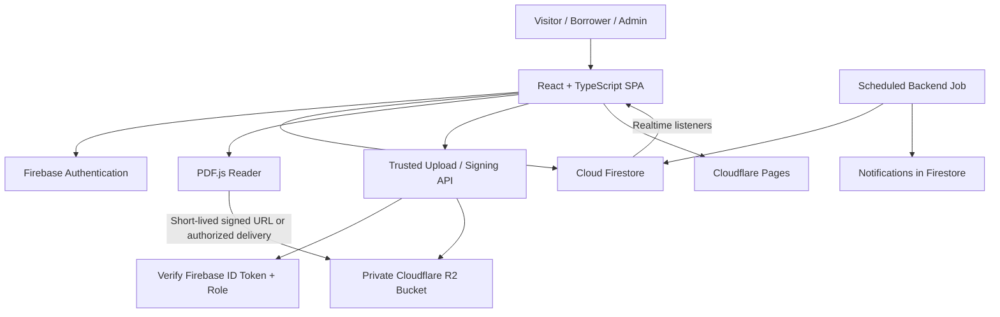

# ARCHITECTURE.md — Shibir Library

## 1. Approved Architecture
- **Frontend:** React + TypeScript + Vite
- **UI:** Tailwind CSS, shadcn/ui, Lucide React
- **Routing:** React Router
- **Identity:** Firebase Authentication
- **Application data:** Cloud Firestore
- **PDF and cover storage:** Cloudflare R2
- **Frontend hosting:** Cloudflare Pages
- **PDF rendering:** PDF.js
- **Testing:** Vitest, React Testing Library, Playwright
- **Repository:** GitHub

## 2. High-Level Diagram



## 3. Trust Boundaries
The browser is untrusted. Any value supplied by a client can be modified.

### Browser may
- Sign in through Firebase Auth.
- Read public published books and history.
- Read/write only explicitly permitted user-owned records.
- Request a signed upload/download URL from the trusted API.
- Render a PDF using a short-lived URL when allowed.

### Trusted server-side layer must
- Verify Firebase ID tokens.
- Verify admin role or resource ownership.
- Validate file type, file size, and allowed operation.
- Create short-lived R2 presigned URLs or perform R2 operations.
- Validate request status transitions.
- Reserve/release inventory atomically or idempotently.
- Perform privileged admin actions.
- Run scheduled reminders and avoid duplicates.
- Write audit records for important transitions.

**Important:** Cloudflare Pages hosting alone does not automatically provide a secure R2 upload backend. Choose a compatible trusted runtime (for example, a Pages Function or Worker) only after checking current free limits and runtime support. Keep R2 secrets in server-side environment secrets, never in `VITE_*` variables.

## 4. Storage Design
Use a private R2 bucket by default. Suggested object key layout:

```text
covers/{bookId}/{version}-{safeFilename}
pdfs/{bookId}/{version}-{safeFilename}
history/{articleId}/{version}-{safeFilename}
```

Rules:
- Store object keys and file metadata in Firestore; do not store PDF bytes in Firestore.
- Never trust a client-supplied object key without checking authorization and allowed prefix.
- Restrict content types to approved image/PDF types and enforce file-size limits.
- Use random/versioned object names to avoid accidental cache collisions.
- Avoid storing permanent public URLs for private files.
- Signed URLs expire; clients should request a fresh URL when needed.
- Configure R2 CORS for known app origins and required methods/headers only.
- Define orphan-file cleanup and deletion behavior.
- Before deleting a book, check whether active loans or references require archival rather than hard deletion.

## 5. Firestore Collections
Recommended initial schema:

### `users/{uid}`
```ts
{
  displayName: string;
  email: string;
  photoURL?: string;
  position?: "supporter" | "well_wisher" | "worker" | "associate" | "member";
  address?: string; // private; collect only when needed
  role: "user" | "admin"; // trusted assignment only; client cannot self-set
  createdAt: Timestamp;
  updatedAt: Timestamp;
  status: "active" | "suspended";
}
```
Prefer custom claims for admin authorization when a trusted backend is available. If a role field is used, ensure only trusted code can set/change it.

### `categories/{categoryId}`
```ts
{
  nameBn: string;
  slug: string;
  order: number;
  active: boolean;
  createdAt: Timestamp;
  updatedAt: Timestamp;
}
```

### `books/{bookId}`
```ts
{
  title: string;
  author?: string;
  categoryId: string;
  description?: string;
  coverObjectKey: string;
  pdfObjectKey?: string;
  externalPdfUrl?: string;
  downloadAllowed: boolean;
  language: string;
  publicationInfo?: string;
  status: "draft" | "published" | "archived";
  featured: boolean;
  createdAt: Timestamp;
  updatedAt: Timestamp;
  createdBy: string;
  updatedBy: string;
}
```
Require exactly one valid PDF source (`pdfObjectKey` or approved `externalPdfUrl`) when publishing a PDF book.

### `physicalBooks/{physicalBookId}`
```ts
{
  digitalBookId?: string;
  title: string;
  author?: string;
  coverObjectKey?: string;
  totalCopies: number;
  availableCopies: number; // maintained by trusted logic; never client-editable
  active: boolean;
  createdAt: Timestamp;
  updatedAt: Timestamp;
}
```

### `bookCopies/{copyId}`
```ts
{
  physicalBookId: string;
  inventoryCode?: string;
  status: "available" | "reserved" | "borrowed" | "damaged" | "lost";
  location?: string;
  activeLoanId?: string;
  updatedAt: Timestamp;
}
```
If individual copies are tracked, derive counts or update them transactionally. Avoid conflicting count sources.

### `borrowRequests/{requestId}`
```ts
{
  borrowerUid: string;
  physicalBookId: string;
  copyId?: string;
  borrowerName: string;
  address: string;
  position: "supporter" | "well_wisher" | "worker" | "associate" | "member";
  borrowDate: Timestamp;
  dueDate: Timestamp;
  pickupLocation: "house" | "campus" | "other";
  pickupLocationDetails?: string;
  status: "pending" | "approved" | "rejected" | "ready_for_pickup" |
          "borrowed" | "return_requested" | "returned" | "cancelled" | "overdue";
  adminUid?: string;
  decisionReason?: string;
  createdAt: Timestamp;
  updatedAt: Timestamp;
}
```

### `loans/{loanId}`
```ts
{
  requestId: string;
  borrowerUid: string;
  physicalBookId: string;
  copyId?: string;
  borrowDate: Timestamp;
  dueDate: Timestamp;
  status: "active" | "return_requested" | "returned" | "overdue" | "cancelled";
  borrowerReturnConfirmedAt?: Timestamp;
  borrowerReturnConfirmedBy?: string;
  adminReturnConfirmedAt?: Timestamp;
  adminReturnConfirmedBy?: string;
  completedAt?: Timestamp;
  inventoryReleasedAt?: Timestamp; // idempotency guard
  createdAt: Timestamp;
  updatedAt: Timestamp;
}
```

### `chats/{chatId}`
```ts
{
  requestId: string;
  borrowerUid: string;
  participantAdminUids: string[];
  active: boolean;
  lastMessageAt?: Timestamp;
  lastMessagePreview?: string;
  createdAt: Timestamp;
}
```
Messages may live in `chats/{chatId}/messages/{messageId}` with sender UID, text, createdAt, and read metadata. Validate membership on every operation.

### `notifications/{notificationId}`
```ts
{
  recipientUid: string;
  type: string;
  title: string;
  body: string;
  relatedType?: string;
  relatedId?: string;
  createdAt: Timestamp;
  readAt?: Timestamp;
  dedupeKey?: string;
}
```
Use deterministic dedupe keys or a trusted idempotency record for scheduled reminders.

### `historyArticles/{articleId}`
```ts
{
  title: string;
  slug: string;
  summary: string;
  body: unknown; // choose a validated rich-text schema or Markdown format
  imageObjectKeys: string[];
  eventDate?: Timestamp;
  sources: { label: string; url?: string }[];
  status: "draft" | "published" | "archived";
  publishedAt?: Timestamp;
  createdAt: Timestamp;
  updatedAt: Timestamp;
  createdBy: string;
}
```

### `auditLogs/{logId}`
Record sensitive admin actions and important state transitions. Restrict writes to trusted code and reads to authorized admins.

## 6. Core Workflows
### Book upload
1. Admin signs in.
2. UI requests an upload authorization from trusted server.
3. Server verifies Firebase token and admin role.
4. Server validates allowed file type/size and creates a short-lived signed upload URL.
5. Browser uploads directly to R2.
6. UI asks server to verify/complete the upload where feasible.
7. Trusted or validated application logic writes metadata to Firestore.
8. Publish only after required metadata and files are verified.

### Borrow request
1. User signs in.
2. UI submits validated request.
3. Trusted logic verifies dates, user, availability, and duplicate rules.
4. Request is created as pending.
5. Admin approves/rejects through a trusted transition.
6. Approval reserves a copy and creates/updates the loan as one safe transaction or idempotent operation.
7. Approval creates a private chat and notification.

### Return
1. Borrower requests return/marks returned.
2. Admin physically verifies and confirms receipt.
3. Trusted logic checks both confirmations.
4. Transition to returned and release inventory exactly once.
5. Write notifications and audit record.
6. Archive remains accessible to authorized parties.

### Reminder job
1. Scheduled trusted job finds due loans within configured windows.
2. Check status is active and due date matches.
3. Create notification with a unique dedupe key.
4. Skip already returned/cancelled loans and already-sent reminders.
5. Monitor failures and document how the job is deployed and tested.

## 7. Security Rules and Indexes
- Deny by default where possible.
- Public read only for published public records.
- Users can read their own profile and private records.
- Clients cannot assign their own admin role.
- Client updates must not modify privileged fields, inventory counts, approval status, or audit logs.
- Chat access requires membership.
- Notification reads/writes require recipient ownership; client should not create privileged system notifications.
- Use Firestore Rules tests for anonymous, user, and admin personas.
- Add composite indexes required by real queries and commit Firestore index configuration.
- Do not treat UI route guards as access control.

## 8. Reliability and Cost
- Check current Firebase Spark/Blaze requirements for each chosen capability, especially scheduled functions and privileged backend operations.
- Check Cloudflare Pages/Workers free limits before committing to the runtime.
- Never promise permanent zero cost. Keep the application within documented free allowances, monitor usage, and document upgrade triggers.
- Back up Firestore data and R2 objects; test restoration.
- Use pagination and avoid unbounded listeners/queries.
- Cache public assets sensibly, but never expose protected PDFs through public caching.
- Define retention, deletion, and account-suspension policies.

## 9. Provider Portability
Create a storage abstraction such as `storageService` with operations for upload authorization, file URL generation, deletion, and metadata. Business components should store object keys and call the abstraction rather than constructing R2 URLs everywhere. This makes future storage migration less disruptive.
